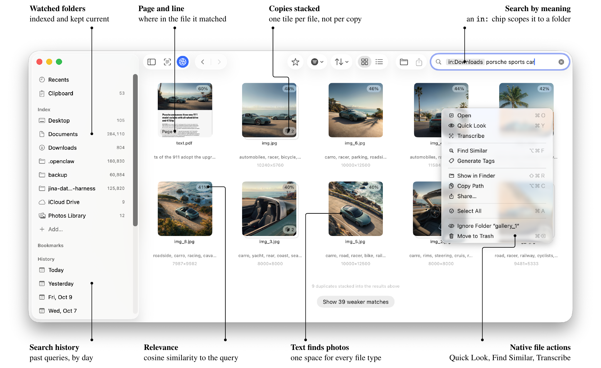

<p align="center">
  
</p>

<h1 align="center">Omni</h1>

<p align="center">Search every file on your Mac by meaning. Fully airgapped.</p>

<p align="center">
  <a href="https://hanxiao.io/omni"><b>Download</b></a>
  &nbsp;&middot;&nbsp;
  <a href="https://arxiv.org/abs/2608.05543"><b>Paper</b></a> (NeurIPS 2026 Workshop on On-Device Intelligence)
</p>

<p align="center">
  <a href="https://hanxiao.io/omni/assets/omni-intro.mp4?v=06b4ad11">
    
  </a>
</p>

Text, code, PDFs, slides, spreadsheets, images, audio and video in one vector space, so any query
finds any kind of file. The embedding model is `jina-embeddings-v5-omni`, ported to MLX-Swift and
running in-process on the GPU. No Python, no server, no cloud.

## Install

Download the DMG from [hanxiao.io/omni](https://hanxiao.io/omni) or
[Releases](https://github.com/hanxiao/omni-macos/releases) and drag Omni to Applications.

On first launch Omni downloads its search model (1.8 GB), and optionally the OCR model (4.2 GB)
for transcribing scans and photos, both from this repository's GitHub releases. After that
nothing leaves the Mac.

## Usage

It browses like Finder, runs on Metal, keeps up as files change, and works with the network
cable pulled.

<p align="center">
  
</p>

## Linked Macs

<p align="center">
  <a href="https://hanxiao.io/omni/assets/omni-linked-macs.mp4?v=a687c4ea">
    
  </a>
</p>

File > Link a Mac links another Mac running Omni: open it on both, pick the Mac, and type the
six-digit code one shows into the other. From then on a search here also searches there, on that
Mac's index and GPU, and its files open here as if they were in a folder. No server is involved:
Macs find each other on the local network, or by address over a VPN, and the link is TLS 1.3 with
keys pinned at pairing. A Mac that is off or asleep is simply left out of the results.

## Serving

Settings > Serving exposes an HTTP API on `127.0.0.1:51234` with an MCP endpoint at `/mcp`.

```bash
curl -sX POST localhost:51234/v1/search -d '{"query": "invoice from march"}'
curl -sX POST localhost:51234/v1/sources/add -d '{"path": "~/Projects"}'
```

## Build

```bash
brew install xcodegen
export OMNI_TEAM_ID=XXXXXXXXXX   # your Apple Team ID; a free account works for local builds
./Scripts/build-app.sh           # not a bare xcodebuild: see the script's header
```

Needs Xcode 26 with the Metal Toolchain. The app downloads its models itself; `OMNI_MODEL_DIR`
points it at a local copy instead. `make test` runs the suite, including numeric parity with Python reference
fixtures.

## Citation

```bibtex
@inproceedings{xiao2026omnimacos,
  title     = {omni-macos: On-Device Omni-Modal Search on Apple Silicon},
  author    = {Xiao, Han},
  booktitle = {NeurIPS 2026 Workshop on On-Device Intelligence},
  year      = {2026},
  eprint    = {2608.05543},
  archivePrefix = {arXiv},
  url       = {https://arxiv.org/abs/2608.05543}
}
```

## License

[Apache 2.0](LICENSE). Model weights are under the upstream Jina license (CC-BY-NC-4.0).
